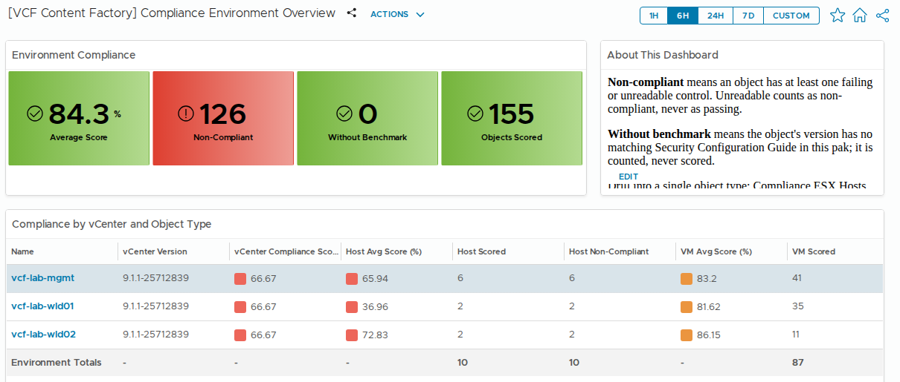
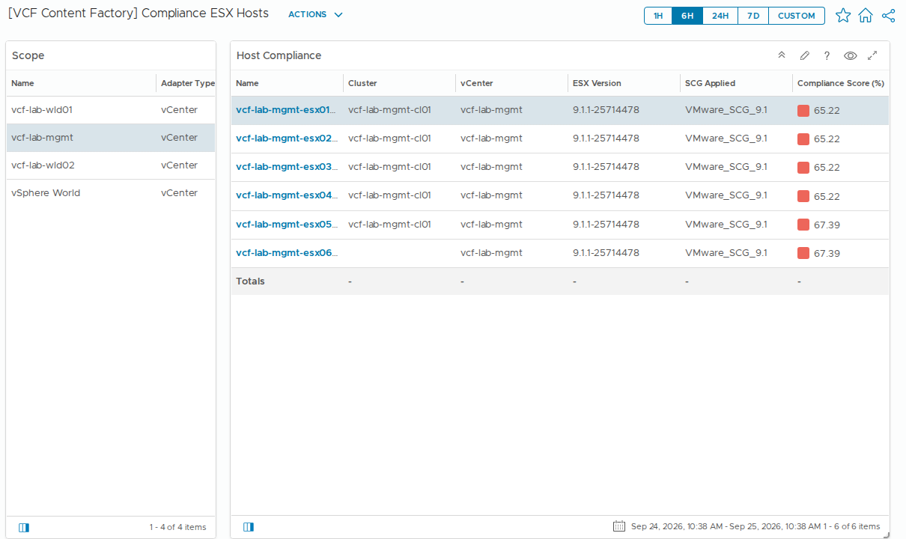
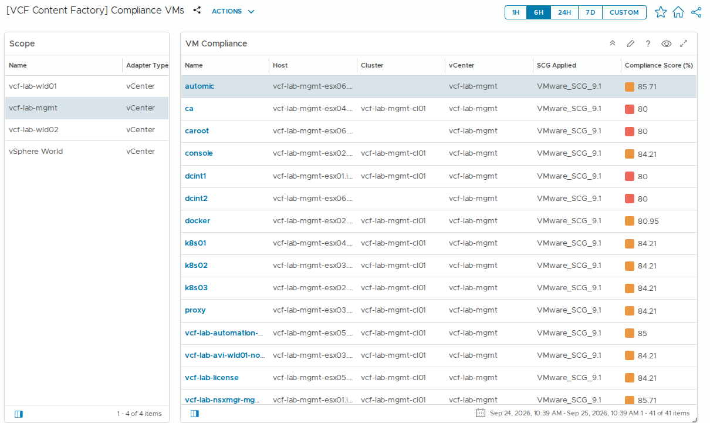
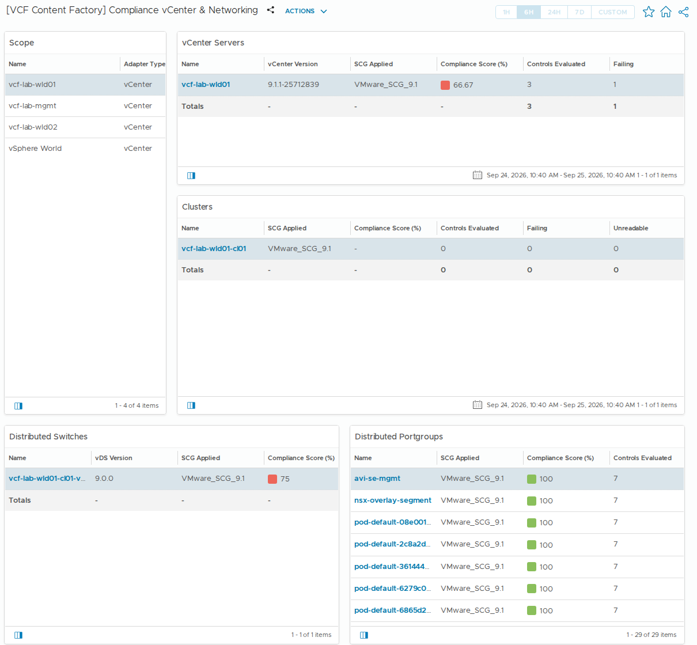

# Compliance for VCF Operations

See how your vSphere environment measures up against VMware's Security
Configuration Guide, right inside VCF Operations.

This management pack reads the security settings on your ESX hosts, VMs,
vCenter, vSAN clusters, and distributed switches and portgroups. It checks
each one against the VMware Security Configuration Guide (SCG) written for
that object's version. The results show up on objects you already monitor:
every one gets a compliance score, every failing control raises its own
alert with VMware's fix attached, and four dashboards (plus a Summary tab
on the pack's Compliance World object) give you the big picture and let
you drill down.

The pack only reads. It never changes a setting.

## What it does for you

**Puts a score on everything you already monitor.** Hosts, VMs,
vCenters, vSAN clusters, switches and portgroups each get a score from 0
to 100 (an object with no guide for its version, or a cluster without
vSAN, has nothing to score and shows none). Open
any of them in VCF Operations, go to All Metrics, then VCF-CF Compliance,
and you'll see each control with the value the SCG expects next to the
value that's actually set. You don't have to learn a separate object tree
or leave the pages you already use. The one relationship the pack adds:
each vCenter object becomes a child of the pack's Compliance World, which
is how the environment totals add up across vCenters (the link is added
every cycle and never removed; see docs/overview.md).

**Uses the right guide for each object.** Most environments are a mix of
versions. By default the pack matches each object to its own guide: hosts
by their ESX version, VMs by their host's version, and everything else by
the vCenter version. The SCG for 6.7, 7.0, 8.0, 9.0 and 9.1 is bundled.
If an object runs a version with no guide yet, it's reported as "no
benchmark" rather than scored against the wrong one. You can also pin
every object to one guide.

**Lets you tune it to your site.** One file in VCF Operations
(Infrastructure Operations > Configurations > Management Packs
Configuration) turns controls off, sets your own
expected values (say 5 failed logons instead of the guide's number), and
pins the guide version per object kind. Nothing is staged on a
collector, and one file can serve several vCenters. See
[Tuning controls and thresholds](docs/overrides.md).

**Turns failures into a to-do list.** Each failing control raises its own
alert, named after the control and prefixed "VCF Content Factory
Compliance Alert:" so the pack's alerts group together, with VMware's
remediation text as the recommendation. Severity follows the SCG's priority (P0 is Critical, P1
Immediate, P2 Warning), so your alert list sorts itself into what to fix
first.

**Tells you when it couldn't check.** If the pack can't read a setting,
because of permissions, connectivity or an unsupported read method, that
setting counts against the score instead of being quietly treated as
fine. A "Compliance data not collected" alert tells you which object is
affected and what to look at. A setting that is simply absent (unset)
fails, with Actual "(undefined)", unless the guide allows it to be unset:
an expected value of "X or Undefined", "X or Not Present" or a bare "Not
Present".

**Keeps each cycle inside the collection interval.** A cycle may take
about 80% of the account's collection interval (240 s at the default 5
minutes), and it also stops after 5 vCenter calls in a row time out.
When a cycle stops early, what was not finished keeps its last values,
"Compliance data not collected" fires on the vCenter, and the next cycle
carries on from where it stopped, so every object is still read every
few cycles. If it keeps happening on a large vCenter, lengthen the
account's collection interval (see docs/installing.md).

## The dashboards

Four dashboards install with the pack, plus a Summary tab on the pack's
Compliance World object: open Compliance World from the inventory and its
Summary tab shows the environment tiles, the per-vCenter table, the score
trend, the SCG version spread and the open compliance alerts on one page.
These screenshots come from a lab with three vCenters.

**Environment Overview** is the landing page: the share of controls
passing across the environment (controls passed over controls evaluated,
from what was read, build 95), beside it the objects the adapter could not
fully read and why, how many
objects are non-compliant, how many have no guide for their version, how
many were scored (so a 0 non-compliant reading is never shown without its
denominator), and how each vCenter is doing broken down by object type. Further down it
shows how many objects are on each SCG version, the score trend and the
open compliance alerts (both of those have open bugs; see Known issues).

**ESX Hosts** starts with a scope. Pick a vCenter, or all of vSphere,
and its hosts are listed worst first with their version, the guide
applied and the score. Select a host to see its trend and details.

**VMs** works the same way, and is built to stay fast with thousands of
VMs.

**vCenter & Networking** puts the object types you have only a few of on
one page: vCenter, clusters, distributed switches and portgroups.

## Installing: allow unsigned paks first

This pak is unsigned, like every pak the VCF Content Factory builds (Broadcom
offers no way for a third party to sign one). VCF Operations 9.0 and 9.1 refuse
unsigned paks out of the box; behavior on 8.x is unverified. The setting below
must be on for each install or upgrade of an unsigned pak:

1. Log in to `https://<primary node>/admin` as `admin`.
2. Administrator Settings, Security Settings: click **Activate Unsigned PAK
   Installation** on 9.1 (**Enable Unsigned PAK Installation** on 9.0). The
   change is refused while any cluster node is down.
3. When uploading the pak (**Administration > Integrations > Repository >
   Add**), tick **Ignore the PAK file signature checking**. The box only
   appears once the setting is on.

With the setting off, the install fails with
`unsigned_pak_installation.not.allowed`. This is a cluster-wide security
setting: it lets any unsigned pak be installed, not only this one, so decide
it deliberately and consider turning it off again after installing. If you do,
it has to go back on before you install the next build. Upgraded appliances
keep whatever state the setting had before the upgrade.

## Getting started

1. Download the latest `.pak` from this repo's
   [Releases](https://github.com/sentania-labs/vcf-content-factory-sdk-compliance/releases).
2. In VCF Operations, install it from **Administration > Integrations >
   Repository > Add**.
3. Add an account for **VCF Content Factory Compliance** under
   **Administration > Integrations > Accounts > Add**. Give it your
   vCenter address, using the name on the vCenter's certificate rather
   than its IP, and a vCenter account with read access (see
   [installing.md](docs/installing.md) for the exact privileges). The
   overrides file and the appliance-settings switch are under
   **Advanced Settings**; you can leave both alone to start.
4. Click **Validate Connection**. If the vCenter certificate is
   self-signed or from a private CA, VCF Operations shows it for review:
   accept it, and the account trusts it from then on. Accepting does not
   fix a name mismatch, which is why step 3 asks for the name on the
   certificate.
5. Wait. The pack collects every 5 minutes, and the per-control alerts need
   a second collection before they fire, so give it about 15 minutes before
   you judge the results. Nothing needs enabling in a policy: the
   overview's score tiles and trend read totals VCF Operations computes on
   the pack's own Compliance World.

The full walkthrough, with permissions, ports and troubleshooting, is in
[docs/installing.md](docs/installing.md).

## Good to know

- **It never fixes anything.** There are no remediation actions. The
  alerts tell you what to change; you change it.
- **vCenter appliance settings are opt-in.** Checking the vCenter
  appliance itself (SSH, NTP, syslog, TLS profile, root password expiry,
  FIPS) requires the account to be in the vsphere.local SSO group
  `SystemConfiguration.Administrators`. That group can also change those
  settings, and VMware offers no read-only equivalent. So this is off by
  default, and those controls are listed for manual review until you
  turn it on.
- **Some controls can't be checked automatically.** Some SCG controls
  expect a written site policy rather than a value, and most vSAN
  controls need a vSAN SDK the pack doesn't have. These are reported for
  manual review and never scored. The list is in
  `profiles/UNAUDITED_CONTROLS.md`.
- **Upgrading from an earlier build: set the collection interval by hand.**
  The default collection interval is now 5 minutes, but an existing
  account keeps the interval it already has (60 minutes on builds before
  85). After upgrading, edit each compliance account and set its
  collection interval to 5 minutes. If you set it through the Suite API
  instead (`PUT /api/adapters` with the body from `GET`), remove
  `collectorId` from the body when `collectorGroupId` is present, or the
  call fails with a 422 whose message ends "Either 'collectorId' or
  'collectorGroupId' should be specified but not both.". Builds before
  86 also installed four compliance super metrics on
  vSphere World; the upgrade removes them from the instance, so there is
  nothing to clean up by hand, and the dashboard that read them is
  re-imported by the same upgrade. Existing alerts are renamed in place
  (alert ids and start times are kept) and existing symptom and alert
  definitions take the new wait and cancel cycles. See [installing.md](docs/installing.md#upgrading).
- **The percentages are controls passing, not an average of objects.**
  (Build 95.) Every percentage on the dashboards is controls passed over
  controls evaluated, so each control on each object counts once (a host
  has several times the controls of a port group); before, each object counted once whatever its
  size, which let many port groups and VMs lift the environment number
  above every low-count kind. Each vCenter object carries, per kind and
  for All, `VCF-CF Compliance|Rollup|<kind>|controls_evaluated`,
  `controls_passed` and `pass_rate`; the Compliance World carries the
  environment sums and `Rollup|Environment|pass_rate`. An object's own
  score follows the same rule: passed over evaluated, from what was read.
  The old averages (`avg_score`) are still collected but no longer shown.
- **Missing data is skipped and flagged, never scored.** (Build 95, Scott
  2026-10-14.) A setting the adapter could not read this cycle is not
  pushed: its last value and any alert on it stay as they were, it is
  outside the object's score and every percentage, and it is never a pass
  or a failure. Instead the object is flagged:
  `VCF-CF Compliance|has_unreadable` = 1 (0 when everything was read,
  pushed every cycle), with `unreadable_count`, `unreadable_reason` (the
  cause in plain words, such as "host not responding" or "permission
  refused", plus the detail the adapter logged) and `unreadable_controls`
  (the control ids, the first 20 then "+N more"). An object with nothing
  readable this cycle (a host vCenter reports not responding, for example)
  pushes only those signals, so its last score and Controls Evaluated stay
  on screen, not current: the **Not Read** column (`has_unreadable`)
  beside the score in the six per-kind views, and the same row in the ESX
  Hosts dashboard's host details, show it. A partial read outage still
  moves the score, over what was read, either way (hiding a passing control
  lowers it), so it can raise or cancel Host Compliance Score Degraded;
  only a whole-object outage leaves the score untouched. The **Objects
  with Unreadable Controls** list next to the Controls Passing tile, on the
  Environment Overview and the Compliance World Summary, names every
  flagged object with its kind, count, reason and control ids (the count
  is from an earlier cycle when even the version could not be read), and
  the object's "Compliance data not collected" alert fires
  after two cycles in a row and clears after one clean cycle. So when a
  whole kind could not be read, its Controls Passing cell keeps its last
  value (never 100 for nothing): the list and the alert are the signal.
  This replaces the build 63 rule, under which an unreadable setting
  counted as failing and pushed -1.
- **The counts cover only objects VCF Operations knows about.** (Build
  88.) A host, VM, cluster, switch or portgroup that vCenter lists but that
  has no matching object in VCF Operations is not scored and not counted
  in the totals, because there is nowhere to put its result. Each vCenter
  object shows how many there were in
  `VCF-CF Compliance|Rollup|<kind>|unmatched` (0 when none), and the
  adapter log names them once per cycle. vSphere Pods (the VMs that run
  Supervisor Pods, which VCF Operations lists as Pods, not VMs) are out of
  scope: they are skipped and counted in
  `VCF-CF Compliance|Rollup|VM|skipped_pods`.
- **Your overrides file shows whether it loaded.** (Build 90.) Each
  vCenter object carries `VCF-CF Compliance|Summary|overrides_file`,
  `overrides_status` (`none`, `OK`, `N rejected`, `absent`, or
  `parse failed, last good from <time>`), `overrides_skipped` and
  `overrides_overridden`; the Compliance World shows the same keys for
  the last account to collect. The alert "Compliance overrides file not
  loaded" fires on the vCenter when the named file is missing or is not
  valid XML. See [docs/overrides.md](docs/overrides.md).
- **The Custom profile CSV is gone.** (Build 92.) The Custom Profile
  CSV Path setting is removed. An account still stored as `Custom` runs
  as `Auto (by version)`; its vCenter's `Rollup|Benchmark|Custom|objects`
  is set to 0 once, on the first complete collection after it is
  configured, so the retired count does not linger. Site changes go in
  the overrides file.
- **No profile choice, no insecure switch.** (Build 93.) The account
  has no Compliance Profile setting: every object is scored against the
  SCG for its own version. To pin a version for the whole account or one
  object kind, use the [overrides file](docs/overrides.md#profile-pin-the-guide-version).
  Allow Insecure SSL is gone too: the vCenter certificate is always
  validated, chain and name, and an untrusted one is accepted in the
  Validate Connection dialog. **Before upgrading, record each account's
  Compliance Profile and Allow Insecure SSL values**: VCF Operations may
  drop them on upgrade, and you need them to pin the old SCG in the
  overrides file and to know which accounts need their certificate
  accepted right after the upgrade. An account that names vCenter by an
  IP or a name not on its certificate stops collecting until you enter
  the certificate's name. Steps:
  [installing.md, Upgrading](docs/installing.md#upgrading).
- **VMs that use a dvfilter on purpose now fail `vm.dvfilter`.** (Build
  90.) The pack now finds `ethernet*.filter*.name` settings, so a VM with a
  dvfilter attached (for example an NSX for vSphere distributed firewall or
  an older agentless security appliance) fails this control and its score
  drops; if that is intended, add `<Skip control="vm.dvfilter"/>` to your
  [overrides file](docs/overrides.md#skip-turn-a-control-off).
- **A Skip now clears the control's open alert.** (Build 92.) A skipped
  control's metric is set to -1 on every collection while the Skip is in
  the file, so its alert cancels after three collections. In build 90
  and 91 it was set once and the alert stayed open.
- **Upgrades keep your accounts.** An existing account keeps its id,
  history and remaining settings. Since build 93 every account runs
  `Auto (by version)`, including one that stored a fixed SCG before; to
  keep such an account on one SCG, add the instance-wide pin to its
  overrides file.

## Known issues

- [#30](https://github.com/sentania-labs/vcf-content-factory-sdk-compliance/issues/30):
  the "Failing Controls on Selected ..." panels on the ESX Hosts, VMs and
  vCenter & Networking dashboards are empty. Until it's fixed, open the
  object and look under All Metrics, VCF-CF Compliance.
- [#31](https://github.com/sentania-labs/vcf-content-factory-sdk-compliance/issues/31):
  the Open Compliance Alerts widget on the overview is empty. The alerts
  themselves are raised; see them in the Alerts list.
- [#32](https://github.com/sentania-labs/vcf-content-factory-sdk-compliance/issues/32):
  the Objects by SCG Version table only shows the 6.7, 7.0 and 8.0
  columns.

All open issues are on the
[issue list](https://github.com/sentania-labs/vcf-content-factory-sdk-compliance/issues).

## More detail

- [How it works](docs/overview.md): what it reads, how scores are
  worked out, and where each result is stored.
- [Scoring, data keys and alerts](docs/data-reference.md): how a guide is
  picked, the full list of metrics and properties, and the alert
  definitions.
- [Installing and configuring](docs/installing.md)
- [Tuning controls and thresholds](docs/overrides.md): turn controls
  off, use your own expected values, pin the guide version.
- [Generated reference](REFERENCE.md) and the
  [inventory tree](docs/inventory-tree.md) (the pack's own object types
  and settings, generated from `describe.xml`)
- [Building from source](docs/building.md)
- [Changelog](CHANGELOG.md)

The bundled benchmarks come from VMware's
[vcf-security-and-compliance-guidelines](https://github.com/vmware/vcf-security-and-compliance-guidelines).
This pack is part of the
[VCF Content Factory](https://github.com/sentania-labs/vcf-content-factory).
